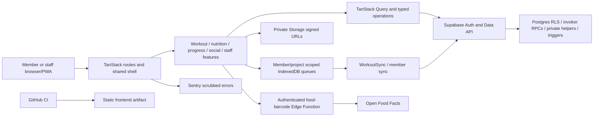

# PRIME FITNESS — PRODUCTION READINESS, ENGINEERING EXCELLENCE & LIFECYCLE OPERATIONS BLUEPRINT

> **15 November update:** Local security and migration mitigations are documented
> in [the remediation checkpoint](readiness/security-remediation-2026-11-15.md).
> Hosted settings/application and full operational acceptance remain pending;
> the launch verdict below is unchanged.

Audit date: **14 November 2026, Africa/Cairo**. Target: invited paid beta. Accountable operator: founder, assisted by coding agents. Monthly infrastructure ceiling: **$100 excluding labor**.

## A. Executive assessment and verdict

**NOT READY — REMEDIATION REQUIRED.** This is an operational launch decision, not a claim that the app is broadly insecure. There is substantial implemented functionality and a strong isolated regression foundation. Paid beta is blocked by hosting suitability, unverified recoverability and environment separation, migration identity drift, privileged access assurance and incomplete release evidence.

Current local HEAD is `3e70114e5f722f8d8a4e4316fa69f123677d1f5b`, with extensive tracked modifications and untracked application files. Results below apply to that working tree, not the committed or deployed application. No change was deployed. Repository metadata reports **public** visibility and `main` as default; this conflicts with the earlier private-repository requirement. Public source is not itself a credential leak.

### Confirmed launch concerns

| ID    | Finding                                                                                                                                | Priority | Launch consequence                                                                      |
| ----- | -------------------------------------------------------------------------------------------------------------------------------------- | -------- | --------------------------------------------------------------------------------------- |
| PF-01 | GitHub Pages currently hosts the test frontend; official usage limits prohibit commercial SaaS hosting                                 | P1       | Move paid beta to a suitable host before accepting real paid users                      |
| PF-02 | Repository is public; documentation describes a private repository                                                                     | P1       | Founder must reconcile visibility, licensing and history exposure                       |
| PF-03 | 40 local and 40 hosted migrations, with eight later migration timestamp differences                                                    | P1       | Do not run a blind database push or rewrite applied history                             |
| PF-04 | Hosted leaked-password protection disabled                                                                                             | P1       | Enable supported protection, verify password policy and recovery before beta            |
| PF-05 | Legacy `private.manages_member` checks assignments/Pod membership but not active access or current role                                | P1       | Review revoked/paused staff visibility through policies using this helper               |
| PF-06 | Effective TRUNCATE privileges exist for anon/authenticated on 44 public tables                                                         | P1       | Revoke unnecessary whole-table grants and review defaults; RLS does not govern TRUNCATE |
| PF-07 | Pages manual deployment bypasses the successful-CI condition; Sentry release uses `github.sha` while checkout can use workflow-run SHA | P1/P2    | Gate manual releases and align build/release identity                                   |
| PF-08 | Restore drill, backup entitlement, production SMTP, privileged MFA and alert delivery not verified                                     | P1       | Operational gates remain open                                                           |
| PF-09 | Sentry text scrubber redacts token/UUID patterns but retains arbitrary non-token error text and non-console breadcrumb messages        | P1       | Validate sensitive-data canaries; implement stricter allowlists where required          |
| PF-10 | Repository formatting fails in two existing redesign documents                                                                         | P2       | Current quality gate is red                                                             |
| PF-11 | Large UI/workflow modules and a single very large browser-test file remain                                                             | P2       | Incremental boundary and test-fixture improvements                                      |
| PF-12 | Full Supabase/Auth/Storage integration, physical-device and deployed-release checks remain unverified                                  | P1       | Mocked/PGlite success cannot close the beta gate                                        |

P1 means must resolve or satisfy the stated gate before paid beta. P2 is planned maintainability/release quality work. No confirmed P0 exploit was demonstrated. PF-05 establishes a missing helper check, not a tested cross-user exfiltration. PF-06 establishes excessive SQL privileges, not an exposed HTTP TRUNCATE endpoint. No destructive hosted probes were attempted.

### Scorecard

Scores assess only the inspected code/configuration subset, not production certification. Unknown operational dimensions are deliberately unscored. Owner F = founder accountable; E = agent/engineer implementation; Q = founder-led independent acceptance.

| Dimension       | Score /10    | Evidence and weakness                                                   | Severity | Improvement / effort                                                   | Owner | Status      |
| --------------- | ------------ | ----------------------------------------------------------------------- | -------- | ---------------------------------------------------------------------- | ----- | ----------- |
| Architecture    | 6            | Feature modules and pure logic exist; several 600–850-line screens      | Medium   | Extract workflows at change boundaries, 3–6 days                       | E/F   | Conditional |
| Code quality    | 7            | Strict TS, 443 unit tests; formatting fails, seven lint warnings        | Medium   | Restore gates, enforce runtime contracts, 1–3 days                     | E     | Conditional |
| Security        | Not Verified | RLS/grants inspected; auth control-plane settings incomplete            | High     | PF-04–06/09 and role matrix, 3–6 days                                  | F/E/Q | Blocked     |
| Database        | 6            | 51 public tables protected by RLS; migration identity/grant issues      | High     | Map history and constrain grants, 2–4 days                             | E/F   | Blocked     |
| Backend         | 6            | Transaction triggers and guarded RPCs; hosted concurrency not exercised | High     | Full-stack/race validation, 2–4 days                                   | E/Q   | Conditional |
| Frontend        | 6            | Broad redesign and recovery UX; visual/device acceptance incomplete     | Medium   | Complete critical-flow acceptance, 3–6 days                            | E/Q   | Conditional |
| Testing         | 7            | 443 units and 12 isolated functional suites pass                        | High     | Real Auth/Storage + browser release matrix, 3–5 days                   | E/Q   | Conditional |
| Performance     | Not Verified | Local warm-query diagnostics only                                       | Medium   | Staging workload and phone baseline, 2–3 days                          | E     | Open        |
| Reliability     | 6            | Durable IDs, revisions and retry tests; no restore drill                | High     | Restore/device fault injection, 3–5 days                               | E/F   | Blocked     |
| Observability   | 5            | Sentry instrumented; alert delivery/privacy not established             | High     | Privacy/alert canary and runbooks, 1–2 days                            | E/F   | Conditional |
| DevOps          | 6            | Pinned Actions, isolated CI, exact checkout; release gaps               | High     | Host and gated artifact pipeline, 2–4 days                             | E/F   | Blocked     |
| Data protection | Not Verified | Private bucket confirmed; retention/legal/restore incomplete            | High     | Counsel decisions and object restore, 2–4 engineering days plus review | F     | Blocked     |
| Operations      | Not Verified | No observed incident or restore exercises                               | High     | Runbook rehearsal and backup operator, 1–2 days                        | F/Q   | Open        |
| Scalability     | Not Verified | No concurrent hosted load evidence                                      | Medium   | Measure before resizing, 1–3 days                                      | E/F   | Open        |
| Documentation   | 6            | Strong feature docs; historical rollout claims are stale                | Medium   | Evidence index, ADRs and runbooks, 2–3 days                            | E/F   | Conditional |

Efforts are focused engineering days, overlap substantially, exclude legal/provider waits and must not be added mechanically.

## B. Current-state technical audit

### Architecture, dependency map and ownership

The application is a **feature-oriented React application with a shared Supabase/Postgres backend**, best described as an evolving modular application with database-centered business rules. It is not a microservices system and not yet a strictly enforced modular monolith.

Browser route guards improve UX; RLS, grants, guarded operations and triggers enforce authority. IndexedDB save acceptance and server reward acceptance are different events. Private media bypasses service-worker caches.

| Subsystem         | Existing owner / files                                                 | Boundary and assessment                                                     |
| ----------------- | ---------------------------------------------------------------------- | --------------------------------------------------------------------------- |
| Routing/runtime   | `src/router.tsx`, `src/start.ts`, `src/server.ts`, `src/routes`        | TanStack Start; Node and static SPA builds both exist                       |
| Workouts          | `src/features/workouts`, `src/lib/workout-sync.ts`, `workout-store.ts` | Durable local edits, stable IDs and finish reconciliation                   |
| Nutrition/offline | `src/features/nutrition`, `src/lib/member-store.ts`                    | Revisioned member mutations, device records and canonical units             |
| Training history  | `src/features/training-import`, `src/lib/personal-backup.ts`           | Import provenance, preview, restore owner/project checks                    |
| Social/cardio     | `src/features/social`, `src/features/cardio`                           | Feature-gated operations, distinct activity metrics                         |
| Staff             | Admin/coaching operation modules in `src/lib`; UI in components/routes | Reviewed operations exist, but presentation and workflow coupling persists  |
| Database          | `supabase/migrations`; generated `src/integrations/supabase/types.ts`  | 40 local migrations, no rewrite proposed                                    |
| Scanner           | `supabase/functions/food-barcode/index.ts`                             | Explicit getUser, allowance RPC, barcode checks, 10-second upstream timeout |
| Monitoring        | `src/lib/sentry.ts`, `sentry-scrub.ts`                                 | Existing error hooks; trace privacy and delivery need verification          |

Manifest ranges are not installed versions. Audit logs show Vitest 4.1.12; package manifest requests ^4.1.10. React 19, Vite 8, Tailwind 4, TanStack Query 5, Supabase JS 2 and Zod 4 are present. Nitro is a beta-version dependency: pin/validate the Node runtime path without forcing an unnecessary framework migration. No Lovable dependency or runtime reference was found in the searched source/manifest/config; no Lovable deployment integration is assumed.

Largest inspected handwritten modules: Rewards route 857 lines; workout-session 835; Profile route 734; coach-training-tools 720; admin-pv-editors 677; exercise-picker 669; admin-shop-workspace 665; social-panel 644; program-builder 643; personal-backup 634. Generated Supabase types are excluded from refactor candidates. Size is a review signal, not a defect by itself.

### Database and migration inventory

Hosted project reports ACTIVE_HEALTHY, EU North region and Postgres 17.11.0.003. This does not establish uptime or patch eligibility. Review provider-supported updates in a scheduled window.

[Evidence register](readiness/evidence-register.md) inventories all 51 public tables and their CRUD policies. The raw metadata snapshot remains local and ignored at `docs/readiness/hosted-metadata-2026-11-14.json`; it records 167 public/Storage policies, five invoker views, 26 public security-definer functions with client EXECUTE denied and the private photo bucket.

Eight local → hosted migration versions differ by name:

- admin_review_active_access: 20261030151207 → 20261107134113
- reviewed_program_editor: 20261030153540 → 20261107134222
- active_shop_administration: 20261030164642 → 20261107134226
- reviewed_schedule_conflicts: 20261101144237 → 20261107134231
- trusted_owner_provisioning: 20261101160432 → 20261107134239
- cardio_social_member_discovery: 20261107133928 → 20261107142546
- friend_request_consent_guard: 20261107143533 → 20261107143632
- full_exercise_catalogue: 20261107211011 → 20261107212031

Equal counts/names do not prove equal SQL. Preserve both histories, obtain deployed statements/checksums, compare schema/grants/functions in a disposable stack, and document an explicit reconciliation mapping before any privileged repair. Some historical docs still call these migrations unapplied: their deployment status is superseded by hosted identity evidence, while content equivalence remains unverified.

Hosted advisors: one password warning, 13 no-policy INFO findings, 40 unused-index INFO findings, no health notices. Default-deny social/internal tables are not automatically vulnerabilities. No index deletion is recommended without actual workload evidence.

### Business-rule correctness

The inspected schema has approval and redemption guards, ledger/XP triggers, frozen program versions, revision/tombstone helpers, imported-record guards and occurrence tracking. Local database tests verify single awards, terminal decisions, stale reviews, original-cost refunds, stock restoration and numeric constraints.

Rank boundaries remain Recruit 1–15, Seeker 16–35, Forged 36–55, Guardian 56–75, Vanguard 76–90 and Prime Legend 91–100. Preserve the million-XP curve and independently configured physical training progression. No beta incentive may reward imported history, invalid warm-up-only work or unsafe additional volume.

Remaining verification: true concurrent transactions on PostgreSQL; actual Auth tokens and role revocation; adversarial restores; historical nutrition target behavior; provider-specific CSV fixtures; actual server rule/configuration equivalence. PGlite substitutes Auth/Storage tables and identity functions, so its successes do not establish real token or object-service behavior.

## C. Production target architecture

Keep the current frontend, database and feature boundaries. Adopt a commercially suitable static host for paid beta; **Cloudflare Pages is the proposed first host to validate**, with a custom domain, controlled previews and security headers. This requires a host-neutral static build: the existing Pages build hardcodes `/Prime-Fitness-App/`, no-index behavior and fallback generation. Do not publish that artifact at root without adapting and testing paths, recovery redirects, PWA scope and deep links.

Production gets its own frontend configuration and Supabase project boundary. CI/PGlite remains synthetic; staging gets a separate Supabase project with synthetic accounts, no production clone by default. Provisioning and billing require founder approval. Avoid read replicas, microservices, Kubernetes, an event bus or a second general-purpose backend.

Incrementally enforce domain imports: routes compose feature entrypoints; feature UI calls typed operations; pure calculations avoid UI dependencies; offline stores own persistence. Extract only when touching behavior, starting with Rewards/Profile orchestration and browser fixtures. Preserve indexed queue schemas and receipt identity across refactors. Document ownership, error types and cancellation contracts rather than introducing a generic repository for every table.

The System and Prime Finance remain separate products and identity/data boundaries. Optional future integration needs consent, explicit scoped contracts and server-authenticated idempotent events. No shared health/financial database, XP transfer or integration endpoint is assumed.

## D. Security and privacy plan

| Threat                         | Entry point                        | Existing mitigation                        | Required verification/remediation                                                   |
| ------------------------------ | ---------------------------------- | ------------------------------------------ | ----------------------------------------------------------------------------------- |
| Account takeover               | Auth/recovery                      | Invitation gate, Supabase session handling | Password protection, MFA for privileged operations, enumeration/rate/redirect tests |
| Former/paused staff access     | RLS helper                         | Assignment restrictions                    | PF-05: role/access recheck, preserved self read/export                              |
| Role escalation                | user_roles/profile writes          | Owner guards and RLS                       | Live-token isolated role matrix, no metadata-based authority                        |
| XP/PV fraud                    | Direct API/RPC and retries         | Server triggers, receipts, ledger          | Concurrent approval/redemption and correction reconciliation                        |
| Whole-table damage             | SQL-capable role/RPC vulnerability | RLS not applicable                         | PF-06: revoke excessive grants/defaults; no destructive hosted probe                |
| Private-photo disclosure       | Storage/signing/cache              | Private bucket, folder policies            | Actual object API cross-member tests and URL expiry                                 |
| Offline cross-account exposure | IndexedDB/cache/tab state          | Member/project namespaces                  | Restart, sign-out, account/project switch and shared-device tests                   |
| Telemetry disclosure           | Errors/traces/breadcrumbs          | Sentry scrub hooks                         | Allowlist or discard arbitrary text/contexts/spans; sensitive-data canaries         |
| Dependency compromise          | npm/CI                             | Lockfile, pinned actions                   | Advisory and secret scanning plus reviewed updates                                  |
| Scanner abuse                  | Edge Function/upstream             | getUser, quota RPC, checksum, timeout      | Untrusted/missing Content-Length bounded body streaming, real JWT/rate checks       |

PF-05: current manages_member ignores staff-role/access checks and is used by measurement, food, session and photo read policies. By contrast can_coach_member checks active access and current coach assignment/role. Define the approved visibility matrix first, then use a forward helper/policy fix and tests for role removal with assignment rows left behind. Do not accidentally remove authorized self access or broaden wellness visibility to Pods.

PF-09: regex-based scrubbing cannot guarantee arbitrary names, notes or food descriptions are removed. Test deliberate synthetic PII in exception messages, DOM breadcrumbs, URLs, extras, contexts and trace spans. Prefer code-only events and explicit allowlists. Preserve operational aggregate sync metrics even when offline network noise is filtered.

Privacy engineering gate: processor list (Supabase region, frontend host, Sentry EU, email, Open Food Facts), Arabic/English notices, specific consent purpose/version, retention and deletion jobs, portability and backup deletion handling. Current consent copy is not legal clearance. Ask qualified Egyptian counsel about Law 151/2020, sensitive data permissions, current implementing rules, cross-border transfers, licensing/DPO and breach obligations. Restrict initial beta to adults in the approved launch jurisdiction; GCC rollout requires country-specific review. No legal compliance certification is issued here.

## E. Testing and performance strategy

Fresh audit evidence:

- TypeScript passed; ESLint passed with seven warnings.
- Vitest: **71 files, 443 tests passed**, 156.30 seconds.
- Twelve isolated functional database suites passed: security 49, reliability 42, progression 44, photos 15, integrity 57, training 50, scheduling 10, redemptions 17, admin reviews 23, program editors 22, shop administration 18, experience 38 assertions/checks.
- Node and static Pages production builds passed; static output scanner checked 20 routes and 198 files.
- Five focused mocked mobile Chromium scenarios reported passing: two-tab persistence/storage failure, restore ownership, onboarding lost receipt, wellness stale edit and legacy draft recovery. Windows web-server teardown can hang after results; see evidence register for final runner status.
- npm audit succeeded after a failed restricted-network attempt: **zero reported vulnerabilities**. Advisory cleanliness is not a supply-chain guarantee.
- Formatting failed in existing onboarding inventory and premium implementation tracker. No application/source formatter was run.

Additional execution results and exclusions are in the evidence register. Historical UI results are not represented as rerun. Full Playwright, full local Supabase, device, external penetration and load tests remain release work.

Risk distribution: pure calculation/validation unit tests; isolated SQL regression tests; full-stack real Auth/Storage integration tests; short synthetic browser journeys; human device/assistive-technology acceptance. Separate a required critical release suite from opt-in screenshots and long benchmarks. Quarantine flakes only with owner, issue, expiry and replacement coverage; never silently skip integrity tests.

Proposed performance acceptance, measured on agreed mid-range Android and representative network: p75 LCP ≤2.5 s, INP ≤200 ms, CLS ≤0.1; p95 local set persistence ≤250 ms; online accepted mutations ≤2 s; dashboard usable ≤3 s; admin analytics ≤3 s at initial beta size. These are targets, not observed results. Measure local commit, queued status and server acknowledgement separately.

Staging load model: initial 20 invited members + staff, 10 concurrent logging clients, 100 repeated save/retry/approval cycles with synthetic IDs. Increase to 50 concurrent clients only after initial correctness holds. Record actual query plans, error rates, p95 and rate-limit responses. Never infer hosted concurrency from warm PGlite timings.

## F. DevOps, environments and release engineering

Retain four CI jobs and immutable Actions revisions. Require type/lint/format/unit, isolated database, Node browser and static-host smoke checks on reviewed PRs. Add secret/history scanning and npm advisory assessment; current workflows do not show an advisory gate. Hooks are optional convenience, not enforcement.

Separate local, CI, staging and production project/host configuration. Publishable/anon browser keys and monitoring DSN are public; database passwords, service-role keys, Sentry upload tokens and scoped management credentials remain operator/CI-only. Store them in an organization-controlled password manager and CI/managed secret stores; ignored .env is a local delivery mechanism, not the authoritative vault. Rotate on actual exposure or access removal.

Gate manual and automatic deployments on the same tested immutable SHA/artifact, record build environment, and make Sentry release identity equal that SHA. Verify branch rules and required environment reviewers through GitHub settings; connector PR-only workflow lookup returned no runs and cannot establish overall CI health. Record actual deployed SHA before beta.

Expand/contract only: migrate staging, test old deployed client plus new client, back up production, apply approved forward migration, deploy matching artifact, smoke-test, observe. Roll back frontend or Edge Function independently; do not reverse populated schema automatically. Feature flags limit availability but do not replace RLS.

## G–H. Launch, recovery and maintenance

Use [operational runbooks](readiness/operations-runbooks.md) for release, rollback, incidents, restore and maintenance. They are proposed procedures, not evidence that backups or alerts exist.

Proposed beta objectives: 99.5% successful eligible authenticated operations monthly, durable local-save failures <0.1%, **zero accepted record loss, cross-member exposure or duplicate awards**. Track first-attempt latency and eventual reconciliation separately. At low beta volume report raw failures with denominators, not misleading percentages.

Recovery target: database and private objects RPO ≤24 hours, service RTO ≤8 staffed hours. Founder must approve the possible loss window before paid beta. Nightly encrypted object copies plus provider database backups do not alone establish a transaction-consistent recovery point; record manifests, reconcile metadata/object availability and prove the target in a restore drill. Shorter reward-ledger loss tolerance requires more frequent verified exports or funded PITR, not an unsupported promise.

Freeze expansion after any integrity/privacy incident or exhausted error budget. Offline logging should remain usable with local capacity while Supabase is unavailable; awards stay pending, scanner/manual entry degrades honestly and secondary analytics can wait.

## I. Scaling and cost

Planning allowance, not a live account quote. Official Supabase pricing currently starts Pro at $25/month, additional projects from $10/month, with daily database backups retained seven days. Current account plan and actual charges are unverified. Private objects require separate backup. Recheck provider terms, quotas and regional taxes before purchase.

| Item                               | Monthly allowance USD | Basis                                                                  |
| ---------------------------------- | --------------------: | ---------------------------------------------------------------------- |
| Supabase production Pro            |                    25 | Published starting price; excludes excess usage                        |
| Separate synthetic staging project |                    10 | Published additional-project starting price                            |
| Static frontend/CDN                |                  0–10 | Proposed Cloudflare Pages; verify current terms/limits and asset sizes |
| SMTP                               |                  0–10 | Provider selection requires deliverability test; allowance only        |
| Encrypted offsite object backup    |                  5–10 | Planning reserve, storage/egress-dependent                             |
| Monitoring/uptime                  |                  0–10 | Existing Sentry plus synthetic uptime; free entitlement unverified     |
| Domain amortization                |                     2 | Allowance; registrar quote required                                    |
| GitHub CI                          |                  0–10 | Depends on visibility/organization plan and minutes                    |
| Usage/tax reserve                  |             remainder | Total 42–87 before reserve; cap approval at $100                       |

PITR/log drains, private-repository plan upgrades, legal/security consultancy and engineering labor are not assumed included. If mandatory requirements exceed the cap, reduce scope or delay beta rather than claim coverage. Cloudflare host selection is a recommendation awaiting configuration and commercial-policy confirmation; no account was provisioned.

Capacity model: sessions = members × workouts/week × weeks; rows = sessions × exercises × sets; photo storage = members × uploads/month × average compressed MiB × retention months; egress = actual downloads × average bytes plus cache misses. Measure uploads, database size, API requests and sync retry traffic weekly.

Review capacity at 20, 50, 100 and 250 active members, not as automatic signup targets. Resize only after sustained CPU/connection/storage/latency evidence and query optimization. Current admin analytics returns the complete roster: keep correct exports, but plan server-paged interactive summaries before larger cohorts. Unused-index counts on a low-volume app do not justify dropping indexes.

## J–K. Backlog and roadmap

The [remediation backlog](readiness/remediation-backlog.md) contains ordering, owners, implementation contracts and closure evidence. Founder capacity assumption for scheduling: **10 focused hours/week engineering oversight/acceptance**, plus **2–3 hours/week operations/support** during beta. Confirm actual availability before committing dates; agent throughput does not replace human review.

Days 1–14: close hosting/visibility decisions, migration mapping, privilege/helper/security defects and formatting gate; establish synthetic staging and exact release identity. Days 15–30: real Auth/Storage integration, restoration and alert drill, policy/legal decisions, critical device acceptance. Days 31–60: invited beta only if gates pass; 10 initial members, increase to 20 after 14 stable days. Days 61–90: stabilize, address actual bottlenecks and review evidence before expanding. Delays move launch; they do not waive gates.

Months 4–6: monthly restore/access/dependency review, support-capacity evidence, measured pagination and import/offline improvements. Months 7–9: reassess capacity and integration contracts, conditional cohort growth. Months 10–12: independent security/recovery review, cost/retention review and annual roadmap. No integration or infrastructure expansion is scheduled without a funded need.

## L. Exact conditions to change the verdict

Change to READY FOR CONTROLLED BETA only when PF-01–09 and PF-12 have accepted closure evidence, required CI is green, release/build identity is known, synthetic staging is isolated, a database+object restore meets approved RPO/RTO, alert delivery and support backup are rehearsed, privacy/retention decisions are approved, and critical EN/AR Android/iOS flows pass.

The uncompleted 1:1 Stitch inventory is a design acceptance gap; it does not alone establish a security blocker. Critical usability/accessibility failures are beta blockers. Wider production requires sustained pilot evidence, independent high-risk security review and funded capacity/support.

## Sources and verification boundaries

Official references checked 14 November 2026:

- [Supabase production checklist](https://supabase.com/docs/guides/deployment/going-into-prod), [environments](https://supabase.com/docs/guides/deployment/managing-environments), [pricing](https://supabase.com/pricing), [backups](https://supabase.com/docs/guides/platform/backups), [password security](https://supabase.com/docs/guides/auth/password-security).
- [GitHub Pages limits](https://docs.github.com/en/pages/getting-started-with-github-pages/github-pages-limits): commercial SaaS restriction and hosting constraints.
- [PostgreSQL RLS](https://www.postgresql.org/docs/17/ddl-rowsecurity.html): whole-table operations are outside row security.
- [OWASP ASVS](https://asvs.owasp.org/), [WCAG 2.2](https://www.w3.org/TR/WCAG22/), [Cloudflare Pages limits](https://developers.cloudflare.com/pages/platform/limits/).
- [Egypt Law 151/2020, official Arabic publication](https://escc.gov.eg/assets/docs/law-151-2020.pdf). Applicability, implementing rules and current regulator procedures require qualified review.

This is a bounded code/configuration and metadata audit, not an exhaustive line-by-line certification, legal opinion or penetration test. Hosted member transactions, private member records and real credentials were not inspected. Exact unavailable checks and fresh results are recorded in the evidence register. No source remediation, hosted mutation, purchase, commit, push or deployment was performed.
